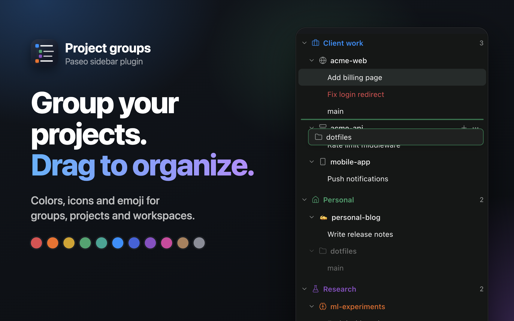
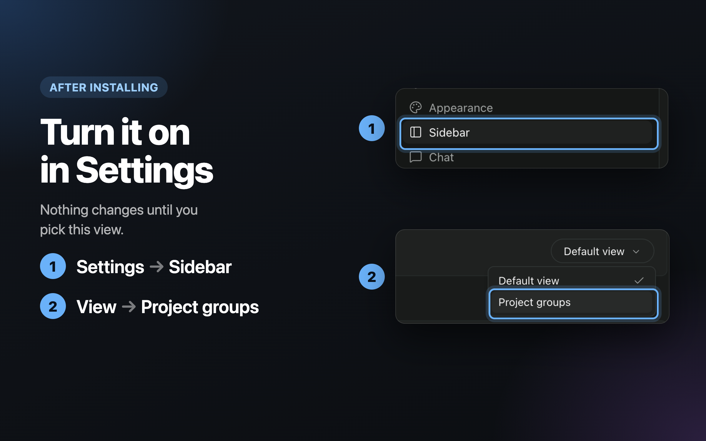

# Project groups for Paseo

Sort Paseo sidebar projects into groups you can drag, fold and color.

**Languages:** English, Korean (한국어), Simplified Chinese (简体中文)



## Install

Find Project groups on the Plugins page in Paseo, or run:

```bash
paseo plugin add topar12/project-groups
```

## Turn it on

Installing does not change the sidebar. Open **Settings → Sidebar** and set **View** to **Project groups**.



## What you can do

- Make groups with **New group** at the top of the sidebar, then drag projects into them.
- Drag group headers to reorder groups. Fold the ones you aren't using, or fold and unfold everything at once from the toolbar.
- Put a project under another project from its ⋯ menu (one level deep).
- With several hosts connected, Ungrouped splits by host and grouped projects show a host tag.
- Give groups and projects a color and an icon (any Lucide icon, searchable by name) or emoji. Workspaces get a color.
- Projects use their Paseo image unless you choose a plugin icon or emoji.
- Folded projects and groups show the most urgent workspace status on their icon, and a light fill when they hold the workspace you have open.
- See which agents started which: lines join a parent agent's workspace with its sub-agents' workspaces, and **By relation** shows all agents as a tree. Turn the lines off in the settings if you don't need them.
- Move through the list with the keyboard in the desktop app and browser, including jumps to an agent's parent and siblings.
- Use the ⋯ menus to move, rename, label, pin, archive or remove things, mark a workspace as read or unread, and open a project's settings.
- Change how workspaces are sorted, titled and labeled from a **Display** menu like the one in Paseo's own sidebar, and text size, row height, space between groups and indentation per device in the settings.
- Read the plugin in English, Korean or Simplified Chinese.

### Nested groups and host sections

In the plugin's appearance settings, enable **Group projects by host** to show collapsible host
sections inside each group. Enable **Compact project/workspace rows** to replace the separate
project heading with rows such as `agent1: Workspace title`. Both options are off by default.
The compact row's grip opens the project menu and supports dragging the whole project; the
workspace's own menu remains on the right. Empty projects retain their normal project row.

Use a group's **⋯** menu to create a subgroup, move the group under another group, or move it to
the top level. Group destinations show full paths. Drag a group to the middle of another group
header to nest it, or near its top/bottom edge to reorder it at that level. Cyclic nesting is rejected.
Deleting a group promotes its subgroups one level and moves its projects to its parent, or Ungrouped
for a root group. Existing groups, colors, folds, and project identities are preserved.
Host sections only change presentation: dropping a project there assigns the containing group,
never transfers the project to another daemon. The By relation view retains its agent tree.

On a phone or tablet, long-press a name before dragging. A quick swipe scrolls the list.

## Requirements

Paseo 0.17.2 or later on both the daemon and the app, with plugins enabled. The development SDK is pinned to 0.17.2.

## Last selected chat title

Choose **Display → Title → Last selected chat title**, or the same choice in the plugin's appearance settings.
When the focused chat's agent starts working (a transition to `running`), its existing title becomes the
workspace's sidebar label. Browsing tabs, including switching to an already running chat, does not select
a new title. New agents first observed running after the view was mounted also count as starts.
The view must be mounted to observe starts; it does not reconstruct missed runs while the client is closed.

The last working chat is remembered separately for each cross-host workspace. Renaming that chat updates
the label even while a terminal, file, or another workspace is focused. Missing/deleted chats and empty
chat titles fall back to the original workspace title/name. **Show → Branch** remains independent.
Only an agent reference is saved, in the device-scoped `chat-titles` settings document; titles are read
reactively from Paseo. No workspace metadata or branch is renamed.

### API compatibility

Checked against the published `@getpaseo/plugin@0.17.2` declarations (not just current website docs):
`PluginSidebarViewProps.active.agent/workspace`, `useAgents`, `useAgent`, agent snapshot
`status/title/workspace`, cross-host refs, and device-scoped `defineSettings`/`useSettings` are present.
The implementation uses subscriptions, with no DOM injection or activity polling.

## Local installation / updating this fork

Keep the installation ID **project-groups**: groups, decorations, appearance, and folding are associated
with that ID and their existing settings document IDs. Do not uninstall/remove the plugin to update it.
On the daemon host, from this checkout:

```bash
npm ci
npm run typecheck
npm test
paseo plugin install "$PWD" --id project-groups
paseo plugin reload project-groups
```

Use the existing installation's daemon home (`--home`) or endpoint (`--host`) if it is not the default.
The directory must exist on the daemon host. Keep it available for subsequent reloads. After editing
an already installed local checkout, run `paseo plugin reload project-groups` again.
Select **Settings → Sidebar → View → Project groups**, then enable the new title mode.
For multiple daemons, install the fork on each relevant host using the same installation ID.
The new selection history is per client device; existing host-scoped groups and colors retain their scope.

## Data

Groups, colors and icons are saved in the plugin's settings on the daemon, so every connected app sees the same groups. Appearance and folding are saved per device. Project icons, label colors and read state go through a local connection to that daemon, and no external service is contacted. Removing a project and checking whether a sub-project's parent still exists also use that connection, because the plugin API has no call for them, and a parent's nesting is cleaned up only when the daemon says the parent is gone. The plugin starts no other programs.

Uninstalling the plugin deletes the saved groups. To get a new version, use `paseo plugin update project-groups` instead.

## Development

```bash
npm install
npm run typecheck
npm test
paseo plugin install "$PWD"
paseo plugin reload project-groups
```

## License

MIT
