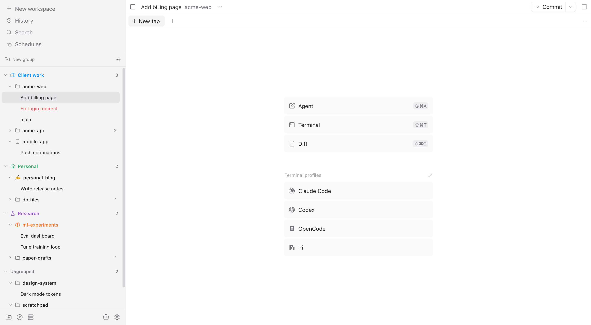

# Project groups for Paseo

A Paseo sidebar view that adds groups above projects. Drag projects between groups, reorder groups and projects, and give groups, projects and workspaces their own colors and icons.



## Features

- Group projects into named groups such as Client work, Personal or Research.
- Drag projects between groups and drag group headers to reorder groups.
- Project and workspace menus: move to group, new workspace, copy path, rename, pin, archive and remove project.
- Colors (11) and icons (36 Lucide icons or any emoji) for groups and projects, colors for workspaces.
- Appearance settings: text size, row spacing, indentation and visible elements.
- English and Korean, following the app language or chosen in the plugin settings.

## Requirements

Paseo 0.16.0-beta.2 or later on both the daemon and the app, with plugins enabled.

## Install

```bash
paseo plugin add git:topar12/paseo-project-groups
```

Then choose **Project groups** in Settings → Sidebar → Sidebar view.

## Data

Groups, colors and icons are stored in the plugin's host settings on the daemon. Appearance and folding are stored per device. Removing a project runs `paseo project delete` on the daemon host, since the plugin API has no project removal call. The plugin makes no network requests.

## Development

```bash
npm install
npm run typecheck
paseo plugin install "$PWD"
paseo plugin reload project-groups
```

## License

MIT
